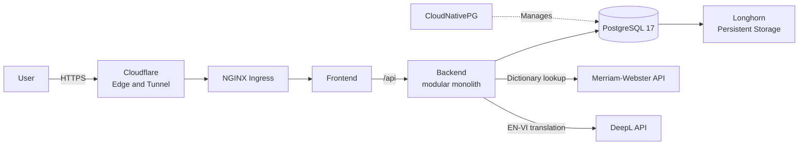

# StudyForge

StudyForge là ứng dụng web học từ vựng tiếng Anh được triển khai theo mô hình CI/CD và GitOps trên Kubernetes On-Premise. Người dùng có thể tra từ, dịch định nghĩa, lưu từ theo bộ sưu tập, theo dõi mức độ ghi nhớ và ôn tập từ vựng bằng flashcard.

- **Live application:** [studyforge.thsown.me](https://studyforge.thsown.me)
- **Application source:** [`studyforge-app/`](./studyforge-app/)
- **Deployment platform:** [`studyforge-gitops/`](./studyforge-gitops/)

Repository GitHub này trình bày toàn bộ dự án trong một cây thư mục để thuận tiện review portfolio. Trong hệ thống triển khai thực tế, application source và GitOps desired state được duy trì ở hai GitLab repositories độc lập.

## Bản đồ repository

```text
studyforge/
├── studyforge-app/       # Product source, containers và Continuous Integration
└── studyforge-gitops/    # Kubernetes desired state và Continuous Delivery
```

| Thư mục                                     | Vai trò                                                                            | Tài liệu chính                                               |
| --------------------------------------------- | ----------------------------------------------------------------------------------- | --------------------------------------------------------------- |
| [`studyforge-app/`](./studyforge-app/)       | Phát triển và kiểm thử sản phẩm; build, verify và publish container images  | [`studyforge-app/README.md`](./studyforge-app/README.md)       |
| [`studyforge-gitops/`](./studyforge-gitops/) | Quản lý deployment state, database, networking, storage và vận hành Kubernetes | [`studyforge-gitops/README.md`](./studyforge-gitops/README.md) |

Mỗi README con là nguồn tài liệu chính cho phạm vi của thư mục đó. README tổng chỉ mô tả mối liên hệ giữa application delivery và deployment platform.

## Kiến trúc end-to-end

### Delivery flow

```mermaid
flowchart LR
    Developer[Developer] -->|Push source| AppRepo[studyforge-app<br/>GitLab]

    subgraph Pipeline[GitLab CI pipeline]
        direction LR
        Validate[1. Validate source<br/>lint, typecheck, tests, build]
        Publish[2. Docker build and push<br/>frontend and backend images]
        Verify[3. Pull and verify<br/>published images]
        Update[4. Update GitOps<br/>values.yaml]
        Validate --> Publish --> Verify --> Update
    end

    AppRepo --> Validate
    Publish -.->|Push commit-SHA images| Harbor[Harbor Registry]
    Harbor -.->|Pull the same images| Verify
    Update -->|Commit image tags| GitOps[studyforge-gitops<br/>GitLab]
    GitOps -->|Watch and sync| Argo[Argo CD]
    Argo -->|Apply desired state| K8s[Kubernetes Cluster<br/>migration and rollout]
    Harbor -.->|Pull deployed images| K8s

    style Pipeline fill:transparent,stroke:#64748b,stroke-width:1px
```



GitLab CI chỉ cập nhật GitOps sau khi hai images đã được build, push lên Harbor và verify thành công. Argo CD phát hiện Git commit mới, áp dụng desired state xuống Kubernetes; các workload sau đó pull đúng commit-SHA images từ Harbor.

### Runtime flow



Request công khai đi theo một chiều từ Cloudflare tới frontend và backend. Backend truy cập PostgreSQL do CloudNativePG quản lý; dữ liệu bền vững được lưu trên Longhorn. Chỉ backend giao tiếp với các external APIs.

## Điểm nổi bật

- Tách biệt application source và deployment state thành hai phạm vi quản lý rõ ràng.
- GitLab CI thực hiện quality gates, build images, runtime verification và GitOps handoff.
- Frontend và backend images được version bằng full commit-SHA tag trên Harbor.
- Argo CD triển khai theo App-of-Apps, sync waves và migration `PreSync` hook.
- CloudNativePG quản lý PostgreSQL; Longhorn cung cấp persistent storage qua CSI.
- NGINX Ingress, cert-manager và Cloudflare Tunnel cung cấp HTTPS cùng public access.
- Application rollback được điều khiển bằng Git thay vì chỉnh workload trực tiếp trong cluster.

## Công nghệ chính

| Lớp                   | Công nghệ                                    |
| ---------------------- | ---------------------------------------------- |
| Application            | TypeScript, Vite, Node.js, PostgreSQL 17       |
| Containers             | Docker, Docker Compose, Harbor                 |
| Continuous Integration | GitLab CI, Docker Runner                       |
| Continuous Delivery    | Argo CD, Helm, GitOps                          |
| Kubernetes data layer  | CloudNativePG, Longhorn CSI                    |
| Networking             | NGINX Ingress, cert-manager, Cloudflare Tunnel |

Chi tiết về tính năng, chạy local và pipeline thuộc [`studyforge-app`](./studyforge-app/). Chi tiết về bootstrap, App-of-Apps, Kubernetes resources và vận hành thuộc [`studyforge-gitops`](./studyforge-gitops/).
