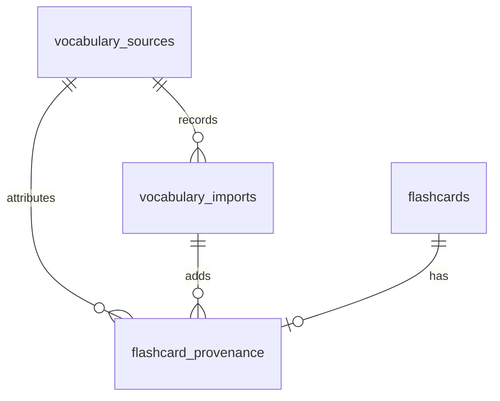

> **Tài liệu V1 (tham khảo):** Chức năng/schema dưới đây chưa phải thiết kế StudyForge V2. Bộ seed đã bỏ và PostgreSQL chưa triển khai. Xem [README](../README.md) để biết trạng thái hiện tại.

# Dữ liệu từ vựng và quy trình nhập

StudyForge lưu từ vựng trong SQLite, phục vụ trực tiếp frontend qua API bài học.
Dữ liệu seed và các ví dụ nhập trong repository là nội dung mẫu tự biên soạn,
không phải bộ 5.000 mục từ của website tham khảo. Không thu thập nội dung sau
đăng nhập, không sao chép database hoặc bộ bài độc quyền của website đó.

## Những gì đã quan sát ở website tham khảo

REA quan sát luồng công khai chủ đề → bài thử → lật thẻ → đánh dấu đã nhớ
(Evidence `ev_44917277187c717ab8f50fb36be950e41096e5948dfa91964a7c71f2eb7d5362`,
trong [Evidence bundle](evidence/reference-session.json)). Thẻ đầu thể hiện cụm từ `early childhood education`, phiên âm, nhãn
`COLLOCATION · IELTS`, từ loại “Cụm danh từ”; mặt nghĩa có bản dịch “giáo dục
mầm non”, thông tin cách dùng và hai câu ví dụ tiếng Anh. Đây là **các trường
thông tin nhìn thấy trong UI**, không phải tên cột database hay hợp đồng API
được xác nhận của website gốc.

Trong lượt ghi nhận đó, 18 request GET quan sát được đều là tài liệu, font,
stylesheet, JavaScript tĩnh Next.js hoặc ảnh/icon; không có XHR/fetch mới trong
các bước chuyển chủ đề, vào bài, lật thẻ và đánh dấu. URL tiếp tục là `/`.
Điều này phù hợp với khả năng dữ liệu đã được tải trước/nhúng trong tài nguyên,
nhưng **không chứng minh website không có backend hoặc database**. Không có
bằng chứng cho một endpoint từ điển hay nguồn cung cấp 5.000 từ cụ thể.

StudyForge hiện lưu một câu ví dụ và bản dịch cho mỗi thẻ. `usage`, nhiều ví dụ,
nhãn `COLLOCATION`/`IELTS`, nguồn phiên âm và nguồn âm thanh chưa phải trường
của import schema đang triển khai; các bảng tương ứng được đề xuất ở cuối tài
liệu. Không tự điền IPA cho dữ liệu seed khi chưa có nguồn được kiểm tra.

## Phạm vi hiện tại

- Mỗi `flashcards` là một mục từ/nghĩa trong một bài học: từ, phiên âm, từ loại,
  nghĩa tiếng Việt, câu ví dụ tiếng Anh và bản dịch.
- CLI nhập **chỉ bổ sung thẻ mới vào bài từ vựng đã tồn tại**. Không tạo bài học,
  không sửa hoặc xóa thẻ có sẵn, không sửa câu hỏi, kết quả kiểm tra hoặc tiến độ.
- Metadata nguồn và giấy phép đi cùng mỗi đợt nhập. Những thẻ thực sự được thêm
  có khóa ngoại tới nguồn và bản ghi nhập.
- Không tự truy cập URL nguồn và không gọi API từ điển bên ngoài. Mọi file cần
  được người duy trì chuẩn bị và kiểm tra quyền sử dụng trước.

## Chạy CLI

Cần Node.js đáp ứng yêu cầu của dự án và database đã khởi tạo. Chạy từ thư mục
gốc repository:

```powershell
npm run db:migrate
npm run db:seed

# Mặc định chỉ xem trước, không tạo database hoặc chạy migration
npm run import:vocabulary -- --file database/import-examples/authored.json

# Chỉ chạy khi đã xem và chấp nhận kế hoạch
npm run import:vocabulary -- --file database/import-examples/authored.json --apply

# CSV dùng metadata nguồn trong tệp riêng
npm run import:vocabulary -- --file database/import-examples/authored.csv --source database/import-examples/authored-source.json
npm run import:vocabulary -- --file database/import-examples/authored.csv --source database/import-examples/authored-source.json --apply
```

Lệnh Node tương đương, không cần npm package runtime:

```powershell
node --env-file-if-exists=backend/.env --experimental-strip-types backend/src/modules/vocabulary-import/cli.ts --file database/import-examples/authored.json
```

Đường dẫn database lấy từ `DATABASE_PATH` trong môi trường / `backend/.env`,
mặc định `data/studyforge.sqlite`. `--database` ghi đè lựa chọn đó:

```powershell
npm run import:vocabulary -- --file database/import-examples/authored.json --database data/studyforge.sqlite
```

CLI không tạo database mới khi gõ nhầm đường dẫn. Dry-run mở database với
`readOnly: true`, chỉ chạy SELECT và các PRAGMA thuộc kết nối; không migrate,
seed hoặc sửa nội dung. Nếu thiếu migration provenance, kế hoạch vẫn đọc được
curriculum có sẵn và ghi cảnh báo. `--apply` áp dụng migrations còn thiếu rồi
nhập dữ liệu bằng một transaction riêng. Migration có thể tồn tại ngay cả khi
đợt nhập bị từ chối, nhưng không có thẻ hay provenance nhập dở dang.

Mã thoát `0` là kế hoạch/nhập thành công hoặc nội dung đã nhập trước đó. Mã
thoát `1` là lỗi; chi tiết JSON được ghi ra stderr. Báo cáo thành công là JSON
trên stdout, gồm `mode`, `status`, `digest`, số dòng mới/trùng, bài bị ảnh hưởng
và `importId`. Node có thể in cảnh báo API SQLite/TypeScript experimental lên
stderr; cảnh báo đó không phải bản ghi nhập thất bại.

## Định dạng JSON

```json
{
  "source": {
    "id": "curriculum-authored-2026",
    "name": "StudyForge editorial team",
    "url": "https://example.org/studyforge/editorial",
    "license": "authored",
    "attribution": "Nội dung do nhóm biên soạn StudyForge tạo."
  },
  "entries": [
    {
      "lessonId": "vocabulary-education-1",
      "word": "learning journal",
      "phonetic": "",
      "partOfSpeech": "noun phrase",
      "meaning": "nhật ký học tập",
      "example": "Mina writes one question in her learning journal after each lesson.",
      "translation": "Mina viết một câu hỏi vào nhật ký học tập sau mỗi bài học."
    }
  ]
}
```

Các URL `example.org` trong ví dụ là địa chỉ minh họa, không phải nhà cung cấp
dữ liệu. Khi nhập dữ liệu thực, ghi URL thực của tài liệu/phát hành đã được
kiểm tra và thay metadata mẫu.

| Trường nguồn | Quy tắc |
| --- | --- |
| `id` | 2–100 ký tự thường, số, `.`, `_`, `-`; định danh bất biến của nguồn |
| `name` | 1–200 ký tự |
| `url` | URL HTTP(S) tuyệt đối, không chứa username/password |
| `license` | Một trong bốn giá trị được hỗ trợ bên dưới |
| `licenseUrl` | Tùy chọn; nếu có phải là URL HTTP(S) tuyệt đối |
| `attribution` | Bắt buộc, không rỗng với CC BY và CC BY-SA; tối đa 2.000 ký tự |

Nếu thiếu `licenseUrl` cho một giấy phép Creative Commons được hỗ trợ, importer
điền URL định danh giấy phép tương ứng. Đây không phải bằng chứng rằng dữ liệu
nguồn đã được chủ sở hữu phát hành theo giấy phép đó. Với `CC0-1.0` hoặc
`authored`, attribution bỏ trống được thay bằng tên nguồn.

| Trường mục từ | Quy tắc |
| --- | --- |
| `lessonId` | Bắt buộc; ID của bài hiện có thuộc track `vocabulary`; tối đa 160 ký tự |
| `word` | 1–200 ký tự; không chứa xuống dòng |
| `phonetic` | Có thể rỗng hoặc bỏ qua trong JSON; tối đa 200 ký tự |
| `partOfSpeech` | 1–80 ký tự; không chứa xuống dòng |
| `meaning` | 1–1.000 ký tự |
| `example` | 1–2.000 ký tự |
| `translation` | 1–2.000 ký tự |

Các trường lạ bị từ chối để phát hiện lỗi chính tả schema. Không hỗ trợ `topicId`
thay cho `lessonId`: người biên soạn phải chọn rõ bài học nhận thẻ.

## Định dạng CSV

CSV chứa đủ bảy cột sau, tên chính xác và không trùng nhau; có thể đổi thứ tự:

```csv
lessonId,word,phonetic,partOfSpeech,meaning,example,translation
vocabulary-education-1,learning journal,,noun phrase,nhật ký học tập,"She writes notes, questions, and examples.",Cô ấy viết ghi chú và câu hỏi.
```

- Mã hóa UTF-8, có hoặc không có BOM; tệp không phải UTF-8 bị từ chối.
- Dấu phẩy phân cách cột; ô chứa dấu phẩy, dấu nháy hoặc xuống dòng phải được
  bọc trong dấu nháy kép. Một dấu nháy bên trong ô được viết `""`.
- Hỗ trợ CRLF, LF hoặc CR ở cuối dòng; giữ xuống dòng nằm trong ô được trích dẫn.
- Trích dẫn chưa đóng, ký tự thừa sau dấu nháy đóng, dòng sai số cột hoặc dòng
  trống giữa dữ liệu đều bị từ chối.
- `--source` trỏ tới JSON chứa object metadata nguồn, không bọc thêm `source`.
  Không dùng `--source` cùng file nhập JSON để thay metadata một cách ngầm định.

Giới hạn mặc định: **5 MiB dữ liệu đầu vào**, **10.000 dòng**, **64 KiB manifest
nguồn CSV**. Mọi dòng được validate trước khi thêm bất kỳ thẻ nào. Ví dụ JSON và
CSV đi kèm cố ý có nội dung tương đương: nếu đã nhập JSON rồi nhập CSV, những
mục từ trùng sẽ được bỏ qua, không ghi đè câu ví dụ đang có.

## Giấy phép và ghi công

Importer nhận các khai báo sau:

| Giá trị | Điều kiện nhập của công cụ |
| --- | --- |
| `CC0-1.0` | Người duy trì đã kiểm tra dữ liệu cụ thể được phát hành CC0 |
| `CC-BY-4.0` | Có metadata nguồn và nội dung attribution không rỗng |
| `CC-BY-SA-4.0` | Có attribution; người duy trì phải đánh giá và thực hiện nghĩa vụ share-alike trước khi phân phối |
| `authored` | Nội dung tự biên soạn, người duy trì có quyền cung cấp cho dự án |

Không chấp nhận các nhãn mơ hồ như `free`, `public`, `educational-use`, hoặc
`all-rights-reserved`. Không suy luận giấy phép từ việc một website công khai,
không gán cùng một giấy phép cho mọi mục từ/câu ví dụ của một nhà cung cấp.
Ví dụ, [Tatoeba Downloads](https://tatoeba.org/en/downloads) ghi các file chung
theo **CC BY 2.0 FR**, chỉ một phần câu có bản **CC0 1.0** và giấy phép âm thanh
do từng người đóng góp chọn. Importer hiện hỗ trợ `CC0-1.0` nhưng **không hỗ trợ
CC BY 2.0 FR**; không được đổi nhãn thành `CC-BY-4.0` để qua validation. Khi cân
nhắc Wiktionary, Tatoeba hoặc nguồn tương tự, phải kiểm tra đúng dump/API,
phiên bản và từng loại nội dung; không coi toàn bộ dịch vụ là một bộ dữ liệu có
cùng quyền tái sử dụng. CLI không thay thế việc rà soát đó.

Nội dung ghi công và URL giấy phép được giữ trong database để phục vụ xuất dữ
liệu/biên tập. Giao diện người học hiện **chưa có trang hiển thị attribution từng
thẻ**; vì vậy trước khi công bố dữ liệu CC BY/CC BY-SA, người triển khai phải bổ
sung phần ghi công hiển thị hoặc tài liệu phân phối phù hợp với nguồn đã chọn.
Không dùng CLI để coi bước này là đã hoàn tất.

## Chống trùng, provenance và transaction

Migration `002_vocabulary_provenance.sql` bổ sung:



- `vocabulary_sources`: định danh, URL, giấy phép, URL giấy phép và attribution.
  Cùng ID với metadata khác bị từ chối; không sửa nguồn lịch sử.
- `vocabulary_imports`: SHA-256 của document chuẩn hóa, phiên bản importer,
  số dòng mới/trùng, thời điểm nhập. Cặp `(source_id,input_sha256)` là duy nhất.
- `flashcard_provenance`: nối thẻ mới với nguồn và đợt nhập, lưu khóa nội dung
  SHA-256. Seed cũ không tự được gán nguồn nhập.

Khóa chống trùng là `lessonId + word + meaning + partOfSpeech`, chuẩn hóa NFKC,
chữ thường và khoảng trắng. Cùng từ nhưng nghĩa hoặc từ loại khác vẫn có thể
là thẻ khác. Khóa này không phải hệ thống phân biệt từ đồng âm hoàn chỉnh.

Trùng với dữ liệu có sẵn hoặc dòng đã gặp trong cùng tệp được bỏ qua; dòng đầu
tiên được giữ. Khác câu ví dụ/phiên âm không tạo bản sửa đè. Lặp lại cùng source
và digest trả `already-imported` và thêm 0 thẻ. Document khác chỉ thêm các khóa
chưa tồn tại. Khi có thẻ mới, vị trí được nối sau `MAX(position)` của bài.

Apply dùng `BEGIN IMMEDIATE`, kiểm tra lại kế hoạch dưới khóa ghi, rồi thêm nguồn,
ledger, flashcards và provenance trong cùng một transaction. Bất kỳ lỗi nào
rollback cả đợt nhập; không sửa hay xóa dữ liệu trước đó.

**Giới hạn chương trình học:** thêm thẻ không tự sinh câu hỏi kiểm tra. Quiz
cũ vẫn giữ nguyên và tiến độ người học cũ không tự bị reset. Người duy trì cần
biên tập đề, xác định lại chính sách xuất bản và kiểm thử học thử/ôn tập trước
khi mở rộng curriculum dùng thật.

## Hướng phát triển schema

Schema hiện tại phù hợp bộ bài nhỏ, một nghĩa cho mỗi thẻ. Khi cần từ điển nhiều
nguồn và nhiều nghĩa, nên tách:

1. `lexemes`: lemma, ngôn ngữ, dạng chuẩn; `lexeme_forms`: biến thể, dạng chia.
2. `senses`: nghĩa, từ loại và phạm vi dùng; `sense_translations`: bản dịch theo ngôn ngữ.
3. `pronunciations`: IPA, vùng giọng và nguồn âm thanh được cấp phép riêng.
4. `example_sentences`: câu độc lập, bản dịch, tác giả và giấy phép từng câu.
5. `source_records`/`attributions`: ID nguồn gốc, phiên bản dump, giấy phép, lịch sử nhập.
6. `lesson_cards`: liên kết curriculum với sense/example thay vì sao chép nghĩa vào từng bài.

Đây là thiết kế đề xuất, **chưa phải schema đang triển khai**. Chưa có downloader,
đồng bộ nền, auto-translation, công cụ xuất bản nội dung hay tích hợp API từ điển.

## Kiểm thử

```powershell
node --experimental-strip-types --test tests/vocabulary-import.test.ts
```

Tests dùng SQLite trong bộ nhớ, kiểm tra BOM/CSV có dấu phẩy và xuống dòng,
schema/giấy phép không hợp lệ, giới hạn đầu vào, dry-run không ghi dữ liệu,
khóa bài học, chống trùng, idempotency, metadata nguồn bất biến và rollback khi
một lần INSERT giữa transaction bị lỗi.
